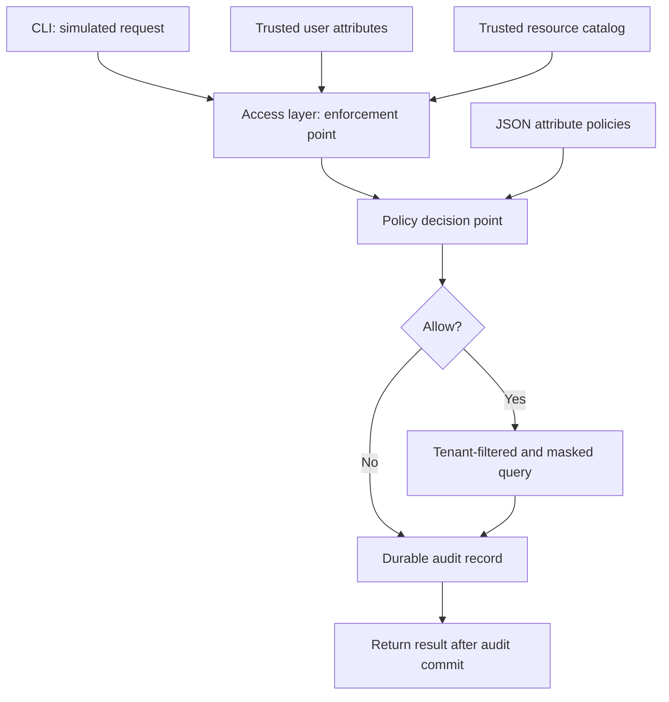

# Secure Data Access Layer with Attribute-Based Controls

A complete Python assignment demonstrating ABAC for a multi-tenant analytics
platform. **No pip installation, Docker, cloud account, or external dependency is
required.** All data is synthetic. Works with Python 3.10+ on Windows, macOS, Linux.

## Quick start (Windows PowerShell included)

Extract the ZIP, then open a terminal inside the `secure_abac` folder:

```powershell
python -m abac demo
python -m abac personas
python -m abac audit
python -m unittest discover -s tests -v
```

The demo automatically creates `data/analytics.db` and runs nine scenarios.
Expect **4 ALLOW and 5 DENY decisions**. Masked customer values appear as `null`.
Running again appends fresh audit records, without duplicating sample rows.

## Try requests yourself

```powershell
python -m abac query --user alice --resource acme.customers
python -m abac query --user bob --resource acme.customers
python -m abac query --user carol --resource beta.orders
python -m abac query --user carol --resource acme.orders
python -m abac query --user bob --resource acme.finance --no-mfa
python -m abac query --user alice --resource acme.orders --network public
python -m abac query --user bob --resource acme.orders --lockdown
```

Query exit codes: 0 = served, 1 = denied/query error, 2 = audit unavailable.
An alternative database can be supplied before the command:
`python -m abac --db data/another.db demo`.

## Attribute model

| Category | Attributes | Source in this assignment |
|---|---|---|
| User | tenant, active, clearance, employment, pii_access, purposes, datasets | Trusted `config/users.json` |
| Resource | tenant, dataset, classification, purpose, region | Trusted catalog in `abac/data.py` |
| Action | name (`read`) | Request, validated by enforcement layer |
| Environment | mfa, network, region, lockdown | Explicit CLI simulation |

Clearance levels are ordered: 1 = internal aggregates, 2 = confidential customer
information, 3 = restricted finance. This is a project-specific classification
scheme, not a legal/compliance standard.

## Personas and expected decisions

Persona labels are for explanation only. No policy checks a role name or user ID.

| Persona | Tenant | Clearance | Dataset grants | PII |
|---|---|---|---|---|
| Alice, analyst | acme | 2 | customers, orders | Masked |
| Bob, sales lead | acme | 3 | customers, orders, finance | Visible (internal employee) |
| Carol, partner | beta | 1 | orders | Masked |

| Demo scenario | Expected result | Reason |
|---|---|---|
| Alice reads Acme customers | ALLOW | Meets attributes, PII masked |
| Bob reads Acme customers | ALLOW | Meets attributes and PII conditions |
| Carol reads Beta orders | ALLOW | Own tenant and granted dataset |
| Carol reads Acme orders | DENY | Tenant mismatch |
| Alice reads Acme finance | DENY | Insufficient clearance |
| Bob reads Acme finance | ALLOW | Sufficient clearance and entitlement |
| Bob reads without MFA | DENY | MFA required |
| Alice reads from public network | DENY | Office or VPN required |
| Bob reads during lockdown | DENY | Explicit incident deny |

## Architecture



### Policy decision point (`abac/pdp.py`)

1. Validate the policy file on startup. Invalid configuration stops initialization.
2. Evaluate attribute conditions with typed comparisons; missing/null referenced
   attributes produce a denial, even if another rule could have matched.
3. Require all mandatory guards: active account, matching tenant, sufficient
   clearance, matching region, MFA, and office/VPN network.
4. Apply explicit deny rules before allow rules (deny overrides).
5. Require at least one matching allow rule; otherwise default deny.
6. Evaluate PII conditions to decide whether masking is required.

Supported declarative operators are `eq`, `gte`, `in`, and `contains`. There is
no `eval`, arbitrary Python expression execution, or embedded SQL in policies.
Policies include a version and canonical SHA-256 hash for audit traceability.
Edit `config/policies.json` and rerun the CLI to demonstrate policy changes.
The configuration is loaded once per process; there is no live reloading.

### Policy enforcement point (`abac/service.py`)

- Resolves user/resource attributes from trusted stores, not caller-provided bags.
- Independently enforces tenant isolation and read-only actions even if the policy
  is mistakenly loosened.
- Restricts resource and column identifiers to an internal catalog.
- Binds tenant and limit as SQL parameters and caps results at 100 rows.
- Adds `WHERE tenant = ?` on every query; tenant indexes support efficient reads.
- Projects `NULL` for unauthorized PII columns directly in SQL; unmasked PII is
  never loaded into the response for users without the appropriate grant.
- Denied requests do not execute a sample-data query.
- Commits an audit record before returning any rows. Audit failure releases no data.

### Auditing

All requests through `AccessLayer.request` have a unique request ID, UTC timestamp,
principal, resource, action, ALLOW/DENY, reason, matching rules, policy version/hash,
attribute snapshot, returned-row count, and execution outcome in the `audit` table.
No customer values, tokens, or passwords are placed in audit records. A query error
can have policy decision ALLOW but outcome `query_error`; this distinction separates
authorization from execution. Configuration failures before service initialization
are startup errors rather than access requests.

`python -m abac audit` shows the latest 30 decisions. This is a local operator command,
not an endpoint exposed to analytics users. The full audit data remains in SQLite.
If audit storage fails, a record cannot be persisted there; the CLI reports the error
and releases no response rows.

## Scope and trust boundary

This is an authorization demonstration, **not a production authentication service**.
The CLI intentionally allows selecting a persona and simulating MFA/network/location.
These switches do not prove identity, MFA, IP origin, or geography. In a hosted service,
replace them with verified identity-provider claims and server-observed context;
never accept privileged attributes directly from an untrusted client.

SQLite does not provide per-user row-level security here: isolation is enforced by
the access-layer code. Anyone with the local database/config files can bypass this
application, alter users/policies or edit audit history. Restrict filesystem/database
credentials to the service account and send production audit events to protected,
append-only remote storage. This example does not claim tamper-proof auditing,
regulatory compliance, cryptographic authentication, or protection against a hostile
local administrator. Audit attribute snapshots should have restricted access.

## Files

| File | Responsibility |
|---|---|
| `config/policies.json` | Declarative ABAC policy |
| `config/users.json` | Three realistic subject attribute sets |
| `abac/pdp.py` | Typed policy evaluator and decision model |
| `abac/service.py` | Enforcement, masking, tenant filters and auditing |
| `abac/data.py` | Catalog, sample tables and SQLite initialization |
| `abac/__main__.py` | Interactive-by-command CLI and nine-scenario demo |
| `tests/test_abac.py` | Security and functional tests |
| `DEMO_OUTPUT.txt` | Captured demo from the build environment |
| `VALIDATION.md` | Verification results |

## Suggested assignment demonstration

1. Run `demo` and explain the four attribute categories.
2. Compare Alice and Bob on `acme.customers` to show column masking.
3. Compare Carol's access to Beta and Acme to show tenant isolation.
4. Use `--no-mfa` and `--lockdown` to show environment controls/deny overrides.
5. Run `audit` and explain request IDs, policy versions, reasons and outcomes.
6. Run the tests to demonstrate default denial, isolation, masking and audit failure.

